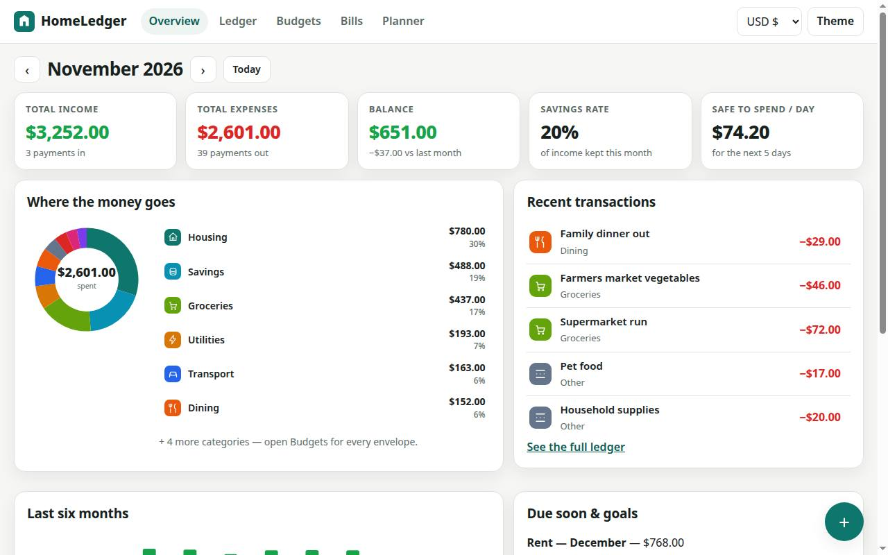
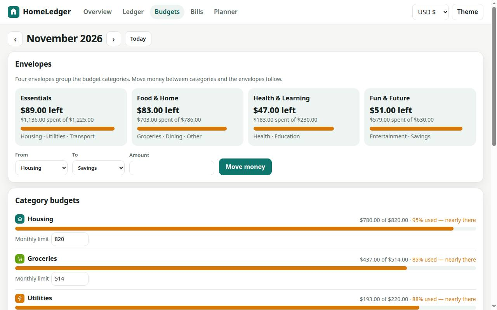
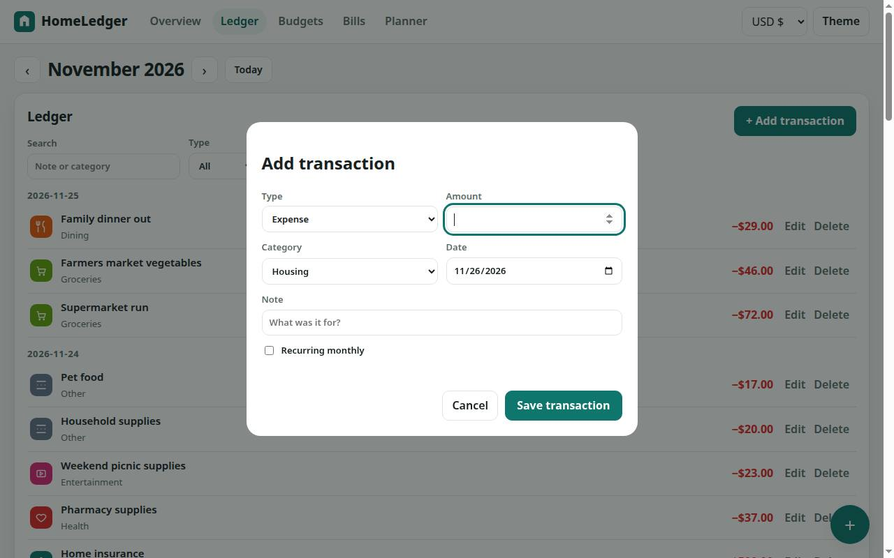
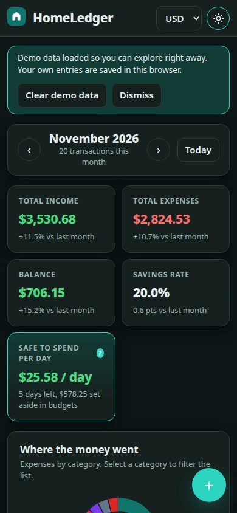

# HomeLedger — Household Budget

[](https://make.fun/bounty/best-household-budget-site-20261126-1457)
[](https://make.fun/bounty/best-household-budget-site-20261126-1457)
[](https://make.fun/bounty/best-household-budget-site-20261126-1457)

HomeLedger is a household budget site that runs entirely in the browser:
no account, no server, no network. Open it, and a realistic demo month is
already there so every chart and figure can be explored right away.

Entry for the make.fun bounty
[Make the best household budget site](https://make.fun/bounty/best-household-budget-site-20261126-1457).

## Screenshots






## What it does

- **Monthly dashboard** — total income, total expenses, balance and savings
  rate for the selected month, each with a comparison against last month,
  and a month navigator with a Today shortcut.
- **Safe to spend per day** — the figure that sets HomeLedger apart:
  (this month's balance so far − budget money still set aside) ÷ days left
  in the month, today included. It uses the current month only, never a
  cumulative balance, and answers "Over plan" instead of a scary negative
  when the month is overspent.
- **Category breakdown** — a hand-built SVG donut plus a ranked list with
  amounts, shares and proportional bars. Selecting a category filters the
  transaction list.
- **Budgets** — a monthly limit per category with a progress bar that turns
  amber when close and red when over, with a plain-language note.
- **Six-month trend** — grouped SVG bars of income versus expenses.
- **Transactions** — add, edit and delete (with Undo), grouped by date,
  with text search and type/category filters. Friendly validation, never a
  silent failure.
- **Data tools** — export and import JSON backups, export CSV, reset all
  data, and a currency picker (USD by default) using Intl.NumberFormat.
- **Themes** — light and dark, following the system preference until the
  visitor picks one; the choice is remembered.

## Demo data

On first run HomeLedger seeds six months of demo transactions. The dates
are generated relative to the day the site is first opened (never in the
future) and current-month amounts scale with the days already elapsed, so
the picture is always sensible: no category takes more than 40% of
spending, the savings rate lands between 15% and 25%, one budget sits near
85% used and one is slightly over. A banner offers to clear the demo data
at any time.

## Design and technical choices

- **Offline-first, zero dependencies.** Plain HTML, CSS and vanilla
  JavaScript modules under `app/`, each file with one clear job:
  `categories.js` (catalogue and icons), `storage.js` (persistence),
  `demo-data.js` (seeded demo set), `calculations.js` (pure figures),
  `charts.js` (SVG charts) and `main.js` (rendering and handlers).
- **Private by design.** All data lives in one versioned localStorage key
  (`homeledger:v1`); nothing leaves the device.
- **Hand-drawn category icons** as inline SVG paths — no emoji, so nothing
  renders as an empty box anywhere.
- **Accessible and responsive** — semantic landmarks, labelled controls,
  visible keyboard focus, AA-minded contrast, a layout that runs from a
  360px phone (floating add button, bottom-sheet form) to a wide desktop.

## Run it locally

```sh
node serve.ts          # serves app/ at http://localhost:8080
```

Or open `app/index.html` in any modern browser — it works from `file://`
too. To build the submission output:

```sh
mkdir -p out && MAKEFUN_OUTPUT_DIR=out node main.ts
```

## License

MIT — see `LICENSE`.
